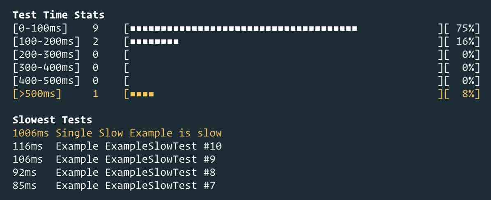

> **🛑 ARCHIVED July 2026 — No longer maintained.**
>
> This project was built for [Karma](https://github.com/karma-runner/karma), a browser-based
> test runner popular in the Angular ecosystem around 2014–2020. The JavaScript testing
> landscape has since evolved significantly:
>
> - **[Vitest](https://vitest.dev)** — A Vite-native test runner with Jest-compatible API.
>   Supports [`slowTestThreshold`](https://vitest.dev/config/slowtestthreshold) and
>   [custom reporters](https://vitest.dev/guide/reporters).
> - **[Jest](https://jestjs.io)** — Meta's test runner. Built-in
>   [`slowTestThreshold`](https://jestjs.io/docs/configuration#slowtestthreshold-number)
>   flags slow tests automatically.
> - **[Playwright Test](https://playwright.dev/docs/test-reporters)** — The standard for
>   browser E2E testing. The HTML reporter includes a Speedboard timeline for identifying
>   slow tests.
>
> These runners work in-process or headless — no browser spawn required — and include
> built-in or easily scriptable slow test detection, making this Karma reporter obsolete.
>
> The **histogram of test execution times** (this reporter's unique feature) is not
> available as a built-in in any of the above runners, but can be implemented as a custom
> reporter via their public APIs.
# karma-time-stats-reporter

[](https://circleci.com/gh/crcatala/karma-time-stats-reporter)

## Description

A Karma Reporter for test times stats. See histogram of time your tests take, and identify slow tests.



## Use In Project

Install package:

`npm install karma-time-stats-reporter --save-dev`

in your karma config:

```js
module.exports = function(config) {
  // other keys ommited for brevity
  config.set({
    plugins: ['karma-time-stats-reporter'],
    reporters: ["dots", "time-stats"],
    // This is config options for the reporter. Listed here are the defaults if you don't provide this any options
    timeStatsReporter: {
      reportTimeStats: true,           // Print Time Stats (histogram)
      
      binSize: 100,                    // Bin size for histogram (in milliseconds)

      slowThreshold: 500,              // The threshold for what is considered a slow test (in milliseconds).
                                       // This is also the max value for last bin histogram 
                                       // Note that this will automatically be rounded up to be evenly divisible by binSize

      reportSlowestTests: true,        // Print top slowest tests

      showSlowTestRankNumber: false    // Displays rank number next to slow tests, e.g. `1) Slow Test`

      longestTestsCount: 5,            // Number of top slowest tests to list
                                       // Set to `Infinity` to show all slow tests. Useful in combination with `reportOnlyBeyondThreshold` as `true`

      reportOnlyBeyondThreshold: false // Only report tests that are slower than threshold

    }
  });
};
```
